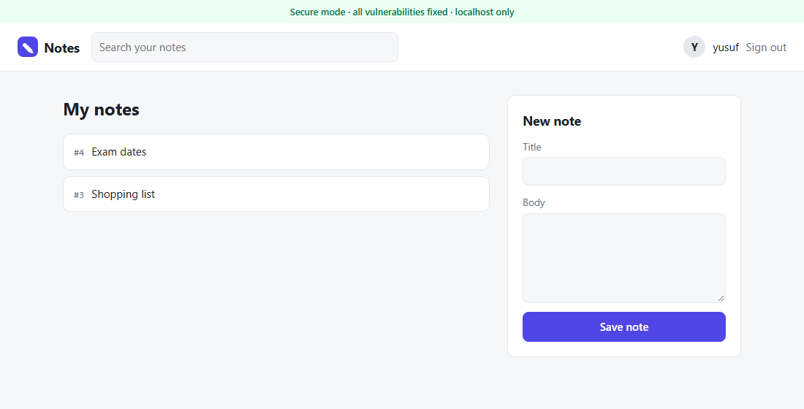
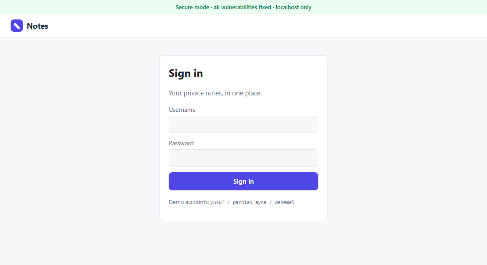
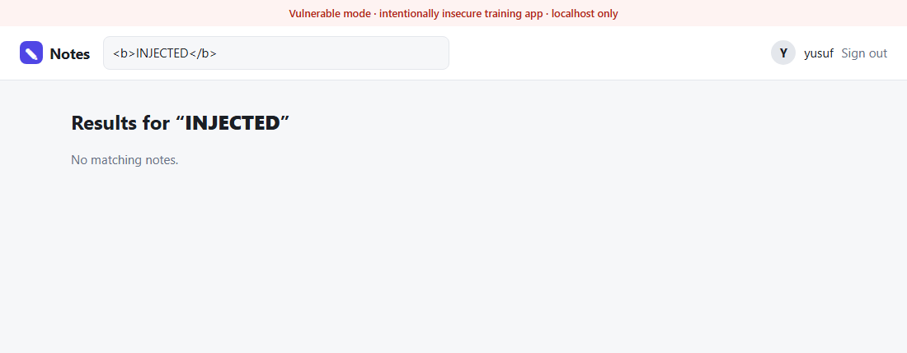

# web-guvenlik-lab

[](https://github.com/yusufiyilmaz/web-guvenlik-lab/actions/workflows/tests.yml)


[](LICENSE)

[English](README.md) | **Türkçe**

**Notes**, tek bir kod tabanından iki kez üretilen küçük ve gerçekçi bir not uygulamasıdır:
yedi yaygın web açığı barındıran **zafiyetli** sürüm ve her açığın kapatıldığı **güvenli**
sürüm. Her açık için reponun gösterdiği üç şey var: **nerede**, **nasıl istismar edilir**,
**nasıl düzeltilir** — hem istismarı hem düzeltmeyi kanıtlayan bir testle birlikte.



> ⚠️ **Güvenlik uyarısı**
> Bu uygulama zafiyetli modda kasıtlı olarak güvensizdir ve **yalnızca localhost'ta** (`127.0.0.1`) çalışır.
> Asla bir sunucuya kurmayın ya da ağa açmayın. Tüm kullanıcılar ve veriler sahtedir.

## İçindekiler

- [Nasıl çalışır](#nasıl-çalışır)
- [Çalıştırma](#çalıştırma)
- [Yedi açık](#yedi-açık)
- [Testler](#testler)
- [Proje yapısı](#proje-yapısı)
- [Lisans](#lisans)

## Nasıl çalışır

Aynı uygulama fabrikası, uygulamayı iki moddan birinde kurar. Açık barındıran her yerde
iki dal yan yana durur; böylece zafiyetli ve güvenli davranış birlikte görünür ve
karşılaştırması kolaydır:

```python
if vuln():
    # ZAFİYETLİ — açığın kendisi
    user = db.execute(f"SELECT * FROM users WHERE username = '{username}' ...")
else:
    # GÜVENLİ — düzeltmesi
    user = db.execute("SELECT * FROM users WHERE username = ?", (username,))
```

| | Zafiyetli mod | Güvenli mod |
|---|---|---|
| Başlatma | `python run.py --mode vulnerable` | `python run.py --mode secure` |
| Adres | http://127.0.0.1:5000 | http://127.0.0.1:5001 |
| Bant | 🔴 kırmızı | 🟢 yeşil |

Her sayfanın üstündeki kırmızı/yeşil bant hangi modda olduğunu her zaman gösterir.

## Çalıştırma

```bash
pip install -r requirements.txt
python run.py --mode secure       # http://127.0.0.1:5001
```

`yusuf` / `parola1` gibi bir demo hesabıyla giriş yap. Veritabanı her başlatmada sahte
verilerle sıfırlanır.

|  |  |
|---|---|
|  |  |
| Giriş sayfası | Reflected XSS: zafiyetli modda arama terimi `<b>INJECTED</b>` metin değil, HTML olarak işleniyor |

## Yedi açık

| # | Açık | OWASP 2021 | Düzeltme |
|---|---|---|---|
| 1 | SQL Injection (giriş ve arama) | A03 Injection | Parametreli sorgular |
| 2 | XSS — reflected (arama) ve stored (not içeriği) | A03 Injection | Çıktı kaçışlama (autoescape, `\|safe` yok) |
| 3 | IDOR (başkasının notunu okuma) | A01 Broken Access Control | Sahiplik kontrolü, bulunamayınca `404` |
| 4 | CSRF (not ekleme/silme) | A01 Broken Access Control | Her POST'ta oturuma bağlı CSRF token |
| 5 | Düz metin parola | A02 Cryptographic Failures | Tuzlu parola hash'i |
| 6 | Koda yazılmış gizli anahtar | A05 Security Misconfiguration | Anahtar ortam değişkeninden, yoksa rastgele |
| 7 | Giriş deneme sınırı yok | A07 Auth Failures | IP başına 5 hata / 10 dk → `429` |

Her düzeltme aynı ilkelere dayanır: **girdiyi kod değil veri olarak ele almak** ve
**her istekte yetki doğrulamak**.

### CSRF düzeltmesi üzerine bir not

CSRF kontrolünün ilk hali, gelen token ile saklanan token'ı doğrudan karşılaştırıyordu.
Henüz token yokken "boş == boş" eşleşip isteği geçiriyordu. Testler bunu yakaladı; kontrol
artık boş token'ı da reddediyor — testlerin neden önemli olduğunu gösteren küçük bir örnek.

## Testler

```bash
python -m unittest -v
```

20 test, her açık için bir çift: istismarın **zafiyetli modda çalıştığını** ve **güvenli
modda engellendiğini**, normal kullanım bozulmadan kanıtlar (geçerli giriş, kullanıcının
kendi notunu okuması, admin'in her notu okuması, token'lı formların başarılı olması).

[GitHub Actions](.github/workflows/tests.yml) testleri her push'ta Python 3.10, 3.12 ve
3.13'te çalıştırır.

## Proje yapısı

```text
notes_app/
  __init__.py        Uygulama fabrikası (zafiyetli / güvenli mod)
  routes.py          Sayfalar; her açığın iki dalı yan yana
  db.py              SQLite şeması + sahte örnek veri
  security.py        CSRF token ve giriş deneme sınırı (güvenli mod)
  templates/         Jinja2 şablonları
  static/style.css   Stil
run.py               Başlatıcı (--mode vulnerable | secure)
tests/               Açık ve düzeltme testleri
scripts/             Ekran görüntüsü üretici
```

## Sorumluluk reddi

Bu teknikler yalnızca bu lab'da ve izin verilen ortamlarda kullanılmalıdır. Sahibi olmadığın
ya da test izni bulunmayan sistemlere karşı kullanımı yasa dışıdır.

## Lisans

[MIT](LICENSE)
